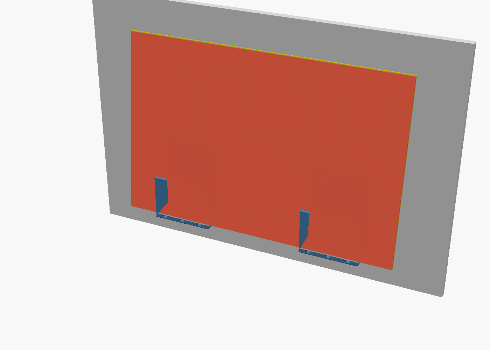
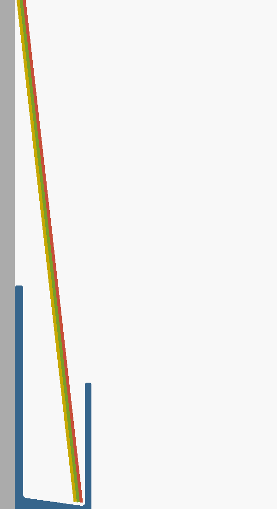

# Flexible Cutting-Mat Rack

A wall or cabinet-door bracket for thin, floppy plastic cutting mats.
**Print 2.** Each takes about 4 h 40 min and 72 g of PETG (PrusaSlicer's generic profile, so your time will differ).



| File | What it is |
|---|---|
| `out/mat_rack_bracket.stl` | **The file to print.** It's already in print orientation. |
| `mat_rack_bracket.scad` | Parametric source. Change the numbers at the top and re-export. |
| `check_model.py` | Builds the model and runs the 28 pass/fail checks. |
| `assembly_preview.scad` | Preview of two brackets with mats (not for printing). |

## How it works

Floppy mats can't stand up by themselves. A thin PP mat buckles under its own weight at about 20–40 cm, so a normal slotted rack lets them slump over.
This bracket never asks them to stand up:

1. The pocket floor slopes **8° down toward the front**, so the mat bottoms slide forward against the lip.
2. Because the bottoms are held 20–34 mm out from the wall, the tops **lean back 3–6°** onto the wall.
   Gravity then pushes the mats flat against the wall instead of letting them fold forward.
3. A 60 mm lip holds the bottom edges, **weep holes** at floor level drain water, and the screws sit **above** the lip so a screwdriver can reach them.



## Fitting

* **Stand the mats on their long edge**, across both brackets. This halves the floppy height compared with standing them on the short edge.
* Place the bracket centres about **22% in from each end of the mat**, which gives the least sag.
  For a 380 mm mat, that puts the centres about 210 mm apart.
  Mount both brackets at the same height (use a level).
* **Screws:** 4 mm / #8 countersunk, two per bracket.
  **On a cabinet door, use 16 mm screws at most** so they don't come out the other side of an 18 mm door.
* **No drilling:** the flat 80 × 110 mm back takes 2–4 heavy-duty Command strips or VHB tape.
  Clean the surface with alcohol first.
* **Inside a cabinet door:** the bracket sticks out 37.2 mm.
  Check that the door still closes past the shelf edges.

## Print settings

| Setting | Value | Why |
|---|---|---|
| Material | **PETG** (or ASA) | Not PLA: wet mats, dishwasher steam and warm kitchens make PLA creep under constant load. |
| Orientation | As supplied: the U-shaped end flat on the bed | No supports, and the bending loads run *along* the layers instead of pulling them apart. |
| Supports | **Off** | Every hole has a 45° roof. |
| Layer height | 0.2 mm | |
| Perimeters | 4 | The walls are 2.6–4 mm, so the part is almost all perimeters anyway. |
| Infill | 15–25% gyroid | |
| Seam | Rear | Hides the seam against the wall. |
| Brim | Optional | Contact area is 794 mm², and the centre of mass sits 13 mm inside the footprint. |
| Bed | PEI with glue stick or a release agent | PETG can rip chunks out of bare PEI. |

## Checks

### Check 1: design rules (before building)

`mat_rack_bracket.scad` will **refuse to compile** if any of these break:

* The pocket fits the full mat stack plus 6 mm.
* The lip wall is a whole number of nozzle widths.
* There's enough material left under the countersinks.
* The screw heads clear the lip top by at least 5 mm (screwdriver access).
* The screws are clear of the ends and the top edge.
* The floor slope is between 5° and 20°.
* The rounding radius can't eat through the lip.
* The weep holes fit the width.
* The part fits a 180 mm bed (Prusa Mini, the smallest common size).

### Check 2: full test run (`python3 check_model.py`)

The first run found **3 problems**, all fixed before release:

| Problem found | Cause | Fix |
|---|---|---|
| Mats collided with the part at every size | Bug in the test (the test mats were tilted the wrong way) | Corrected the rotation |
| Rearmost mat leaned only **2.4°**, below the 3° target | Real design weakness with a full stack of six 2 mm mats | Deepened the pocket from 24 to 30 mm; it now leans 3.3° |
| Slicer refused to run | Wrong flag syntax | Fixed |

A small, real 12–20 mm³ overlap also turned up: a mat's sharp corner against the 1.5 mm fillet inside the floor/lip corner.
The test now drops the mat stack until it rests on the part and requires it to settle within 3 mm of the floor. It settles at 0.7–0.8 mm.

**Final result: 28/28 checks passed**

```
Mesh:     watertight, consistent winding, single body, 63.0 cm³, bbox 110 × 37.2 × 80 mm
Printing: fits a 180 mm bed, 794 mm² first layer, CoM 13.3 mm inside the footprint,
          0.55 mm² beyond 45° (curve facets only) → no supports, thinnest wall 2.61 mm
Function: 6 × 2 mm mats at 150/200/250/300/380 mm tall all settle in (0.7–0.8 mm),
          every mat leans back ≥ 3.3°, lip holds 60 mm, 18 mm spare finger room
Drainage: floor drops 4.2 mm to the lip, all 3 weep holes open at floor level
Screws:   clear straight path through both holes
Strength: 2 kg outward yank on the lip → 8.8 MPa, SF 5.1 (3.3 mm flex);
          the full stack on ONE bracket → floor 7.4 MPa, SF 6
Slicer:   PrusaSlicer 2.7.2, supports OFF → 400 layers, 71.6 g, 4 h 41 m
```

### Questions an expert printer would ask

1. **Why print it on its side?**
   It needs no supports, and the forces on the lip and floor bend the part *within* each layer.
   Printed flat on its back, the same load would try to split the layers apart, which is the weakest direction of any FDM print.
2. **Are there really no supports?**
   Yes. The screw holes are teardrops with countersinks, and the weep holes have pointed roofs.
   The slicer confirmed it with supports turned off.
   The 0.55 mm² flagged above 45° is just the facets of rounded edges.
3. **Why PETG and not PLA?**
   The mats go in wet, kitchens get warm, and the lip is under constant load.
   PLA softens at about 55–60 °C and creeps. PETG handles water and heat better.
4. **Is it food safe?**
   It only touches the edges of the mats, never food, so that's fine.
   Still, rinse it occasionally, because layer lines trap grime.
5. **Will a tall, thin print fall over?**
   It's 80 mm tall on a U-shaped 794 mm² footprint, with the centre of mass 13 mm inside the edge.
   It's stable. Add a brim if your PETG adhesion is weak.
6. **Do the wall thicknesses suit the nozzle?**
   The lip is 3.2 mm, which is exactly 8 lines at 0.4 mm. The thinnest point is 2.61 mm (the floor under the weep holes).
   With a 0.6 mm nozzle, set `nozzle = 0.6` and `lip_wall = 3.6`.
7. **What tolerances are needed?**
   None critical. It's a 30 mm pocket for a stack of at most 12 mm, and the mats are flexible.
   Shrinkage and elephant's foot don't affect function.
8. **What about water pooling?**
   The floor slopes 4.2 mm toward three weep holes cut 0.4 mm *below* floor level, so nothing pools.
   PETG doesn't absorb water.
9. **How strong is the mounting?**
   The mats weigh about 0.1–0.5 kg each. The test assumed a full 3 kg stack on one bracket plus a 2 kg yank, and the safety factor stayed at 5 or more.
   The weak point will be the wall anchor, not the print, so use proper plugs in plasterboard.
10. **How long is the print, and can it be faster?**
    About 4 h 40 m each. Dropping to 3 perimeters and 15% infill, or a 0.28 mm layer height, cuts that a lot without losing strength, because the walls are thin.
11. **What if my mats are a different size?**
    Edit `mat_count`, `mat_thickness` or `width` and run `python3 check_model.py`.
    The asserts and tests rerun automatically against your numbers.
12. **What if I stand the mats on their short edge?**
    The test shows it works at 380 mm tall (3.3° lean), but the long-edge-down layout is more forgiving.

## Re-running everything

```bash
python3 check_model.py      # needs openscad, trimesh, manifold3d, shapely; prusa-slicer optional
```

The G-code in `out/` comes from a generic profile and is only there to check slicing.
**Slice the STL yourself** for your printer.
